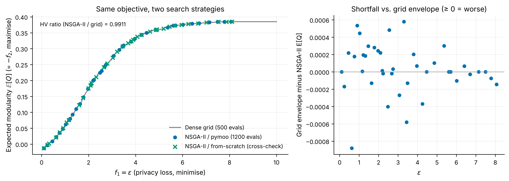
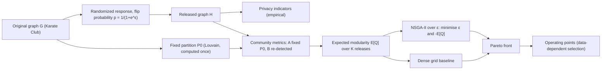
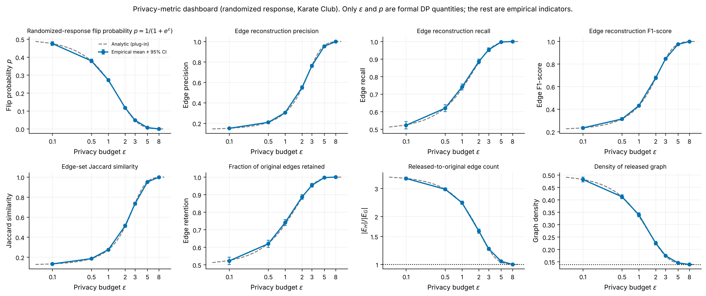
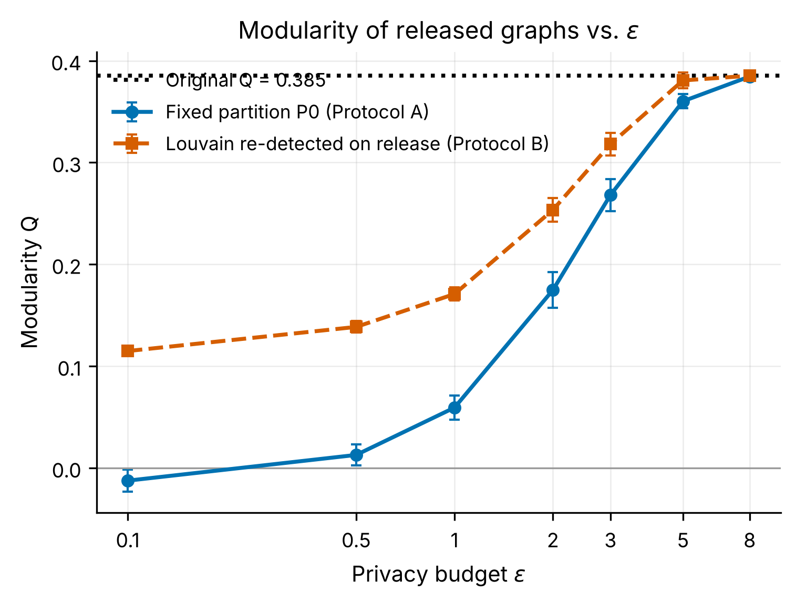
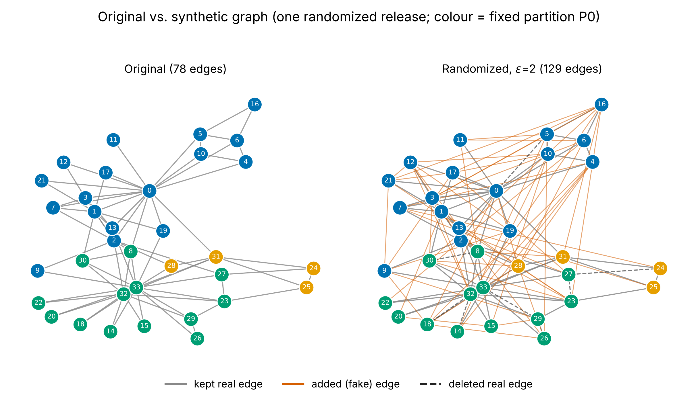
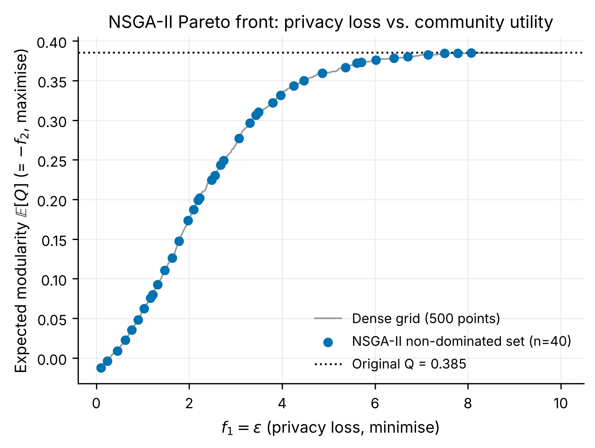

<h1 align="center">Privacy-Preserving Synthetic Graph Generation<br/>Using Multi-Objective Optimization</h1>

<p align="center">
An M.Tech AI research project exploring edge-level differential privacy, randomized response, community-structure preservation, and NSGA-II-based multi-objective optimization for synthetic graph generation.
</p>

<p align="center">


</p>

<p align="center">
<a href="https://arjungopalevolveproject.netlify.app/"><b>🌐 Live interactive website</b></a> ·
<a href="docs/project_overview.md">Docs</a> ·
<a href="results/reports/experiment_report.md">Experiment report</a> ·
<a href="notebooks">Notebooks</a>
</p>



## Contents
[Overview](#overview) · [Contributions](#main-contributions) · [Architecture](#system-architecture) · [Method](#methodology) · [Metrics](#evaluation-metrics) · [Dataset](#dataset) · [Repository structure](#repository-structure) · [Install & run](#installation) · [Visualizations](#sample-visualizations) · [Results](#results) · [Limitations](#limitations) · [Future work](#future-work) · [References](#references) · [Author](#author)

## Overview
**Research problem.** Releasing a social graph can reveal that two specific people are connected. Differential privacy (DP) bounds that disclosure, but the noise that protects edges also blurs community structure. How much structure survives at a given privacy budget ε, and how should ε be chosen?

**Motivation.** Community structure is what most downstream graph analyses need; the privacy–utility trade-off is therefore the central design question for private graph release.

**Objectives**
1. Implement edge-level randomized response (RR) and verify its formal ε-edge-DP property.
2. Quantify privacy indicators and community preservation across ε, with two clearly separated evaluation protocols.
3. Formulate ε selection as a two-objective problem and solve it with NSGA-II, benchmarked against a dense grid search.
4. Compare with baselines, stating exactly which carry a formal DP guarantee.

## Main contributions
* A modular, tested, reproducible implementation (53 unit tests) of RR, privacy/community metrics, NSGA-II (pymoo **and** a from-scratch cross-check) and baselines.
* A strict separation of **formal DP quantities** (ε, p, e^ε, composition) from **empirical indicators** (precision, recall, F1, Jaccard, NMI, …).
* Two community-evaluation protocols (fixed reference partition vs. re-detected), plus the reference values needed to read NMI/ARI honestly.
* A transparent finding that, with ε the only decision variable, the Pareto set is essentially the monotone E[Q(ε)] curve and NSGA-II matches (99.1 % hypervolume) but does not beat a 500-point grid.

## System architecture


## Methodology
### Edge-level differential privacy
Two graphs are *edge-neighbours* if they differ in exactly one node pair. A mechanism is ε-edge-DP if output probabilities for neighbours differ by at most a factor e^ε. This protects the existence of one relationship — **not** a whole node (node-DP) and **not** identities. See [docs/differential_privacy.md](docs/differential_privacy.md).

### Randomized response
Every one of the N = n(n−1)/2 = 561 pairs is flipped independently with probability p = 1/(1+e^ε) (so (1−p)/p = e^ε). Small ε → p≈½ (noise); large ε → faithful copy. One release at fixed ε is ε-edge-DP. Details: [docs/randomized_response.md](docs/randomized_response.md).

### Modularity under a fixed partition
Q(H;P₀) = Σ_c [ L_c/m − (d_c/2m)² ], Q = 0 if m = 0, with P₀ = Louvain on the original graph (computed once). See [docs/community_detection.md](docs/community_detection.md).

### NSGA-II formulation
Decision variable ε ∈ [0.1, 10]. Minimise **f₁(ε) = ε** and **f₂(ε) = −E[Q(H;P₀)]** (modularity is negated because pymoo minimises). E[Q] is the mean over K = 20 releases using common random numbers. Defaults: population 40, 30 generations, seed 42, SBX (p=0.9, η=15), polynomial mutation (η=20). All parameters are configurable via CLI flags. See [docs/nsga2_explanation.md](docs/nsga2_explanation.md).

> **Privacy claims — read this.** One RR release at fixed ε is ε-edge-DP. The NSGA-II/grid search scores candidates against the original graph and selecting an operating point is data-dependent, so the **end-to-end pipeline is not claimed to be differentially private**; repeated releases compose (k releases cost kε). Nothing here is node-level DP or identity anonymisation.

## Evaluation metrics
| Group | Metrics | Nature |
|---|---|---|
| Formal DP quantities | ε, flip probability p, e^ε bound, basic composition | **formal** |
| Empirical edge indicators | precision, recall, F1, Jaccard, retention, edge-count ratio, density, posterior belief | empirical (prior/graph dependent) |
| Structural utility | degree KS/Wasserstein, clustering, path length, components, density | empirical |
| Community (fixed P₀) | modularity, coverage, performance, conductance, intra/inter ratios | empirical |
| Community (re-detected) | modularity, NMI, ARI, assignment consistency, community count/sizes | empirical |

Definitions, "better" direction and caveats for each: [docs/mathematical_foundations.md](docs/mathematical_foundations.md), [docs/community_detection.md](docs/community_detection.md). Source: [`src/privacy/privacy_metrics.py`](src/privacy/privacy_metrics.py), [`src/community/community_metrics.py`](src/community/community_metrics.py).

## Dataset
Zachary's Karate Club (34 nodes, 78 edges, 561 pairs) — [data/README.md](data/README.md). Custom graphs: `--edge-list`.

## Repository structure
```text
├── README.md · LICENSE · CITATION.cff · requirements.txt · CONTRIBUTING.md · conftest.py
├── docs/            8 research documents (DP, RR, communities, NSGA-II, methodology, limitations, ...)
├── data/            README + sample/karate_club_edges.txt
├── notebooks/       01–06 executed notebooks
├── src/
│   ├── common.py · experiment_setup.py
│   ├── graph_generation/   graph_loader, graph_preprocessing, randomized_response
│   ├── privacy/            differential_privacy, privacy_metrics, privacy_analysis
│   ├── community/          community_detection, modularity, community_metrics
│   ├── optimization/       fitness_functions, nsga2_problem, nsga2_optimizer, nsga2_components, pareto_analysis
│   ├── evaluation/         graph_metrics, structural_metrics, baselines, comparison
│   └── visualization/      plot_style, privacy_plots, community_plots, graph_visualization,
│                           convergence_plots, pareto_plots, structure_plots
├── experiments/     run_privacy_comparison · run_community_comparison · run_nsga2 ·
│                    run_baseline_comparison · run_complete_experiment
├── results/         csv/ (+ csv/figure_data/) · figures/ (PNG+PDF) · tables/ · reports/ (metadata JSON)
├── website/         README (source not included — see below)
└── tests/           53 tests across 5 modules
```

## Installation
```bash
git clone https://github.com/ArjunGopal10/privacy-preserving-synthetic-graph-generation.git
cd privacy-preserving-synthetic-graph-generation
python -m venv .venv && source .venv/bin/activate      # optional
pip install -r requirements.txt
python -m pytest -q                                    # 53 tests
```
Optional Leiden support: `pip install python-igraph leidenalg`. Google Colab: each notebook's first cell clones the repo and installs requirements.

### Run the experiments
```bash
python experiments/run_privacy_comparison.py        # Figs 1–8
python experiments/run_community_comparison.py      # Figs 9–17
python experiments/run_nsga2.py                     # Figs 18–23
python experiments/run_baseline_comparison.py       # Figs 24–30
python experiments/run_complete_experiment.py       # everything + results/reports/experiment_report.md
```
Common flags: `--seed 42 --epsilons 0.1,0.5,1,2,3,5,8 --n-releases 20 --results-dir results --edge-list FILE --partition-file P0.json --overwrite`. NSGA-II flags: `--pop-size --n-gen --crossover-prob --crossover-eta --mutation-eta --eps-min --eps-max --grid-points`. Scripts refuse to overwrite existing results without `--overwrite`, and each writes seeds, configuration and library versions to `results/reports/*_metadata.json`. The full pipeline takes well under two minutes on a laptop-class machine.

## Sample visualizations
| | |
|---|---|
|  |  |
| Privacy-metric dashboard (Fig. 7) | Modularity vs. ε, Protocols A and B (Fig. 10) |
|  |  |
| Original vs. synthetic graph (Fig. 9) | NSGA-II Pareto front (Fig. 18) |

<details><summary>All 35 figures (30 requested + 5 extra) — PNG and PDF in <code>results/figures/</code>, plotted data in <code>results/csv/figure_data/</code></summary>

| # | Figure | # | Figure |
|---|---|---|---|
| 1 | [ε vs. flip probability](results/figures/fig01_epsilon_vs_flip_probability.png) | 16 | [intra vs. inter edges](results/figures/fig16_intra_vs_inter_community_edges.png) |
| 2 | [ε vs. precision](results/figures/fig02_epsilon_vs_edge_precision.png) | 17 | [detector comparison](results/figures/fig17_community_detection_algorithm_comparison.png) |
| 3 | [ε vs. recall](results/figures/fig03_epsilon_vs_edge_recall.png) | 18 | [Pareto front](results/figures/fig18_pareto_front.png) |
| 4 | [ε vs. F1](results/figures/fig04_epsilon_vs_edge_f1.png) | 19 | [generation convergence](results/figures/fig19_generation_convergence.png) |
| 5 | [ε vs. Jaccard](results/figures/fig05_epsilon_vs_jaccard_similarity.png) | 20 | [population evolution](results/figures/fig20_objective_space_population_evolution.png) |
| 6 | [ε vs. retention](results/figures/fig06_epsilon_vs_edge_retention.png) | 21 | [crowding / diversity](results/figures/fig21_crowding_distance_and_diversity.png) |
| 7 | [dashboard](results/figures/fig07_privacy_metric_dashboard.png) | 22 | [NSGA-II vs. grid](results/figures/fig22_nsga2_vs_grid_search.png) |
| 8 | [privacy budget](results/figures/fig08_privacy_budget_comparison.png) | 23 | [selected solutions](results/figures/fig23_selected_solutions_tradeoff.png) |
| 9 | [original vs. synthetic](results/figures/fig09_original_vs_synthetic_graph.png) | 24 | [original Karate Club](results/figures/fig24_original_karate_club_graph.png) |
| 10 | [ε vs. modularity](results/figures/fig10_epsilon_vs_modularity.png) | 25 | [low/medium/high ε graphs](results/figures/fig25_randomized_graphs_low_medium_high_epsilon.png) |
| 11 | [ε vs. NMI](results/figures/fig11_epsilon_vs_nmi.png) | 26 | [degree distribution](results/figures/fig26_degree_distribution_comparison.png) |
| 12 | [ε vs. ARI](results/figures/fig12_epsilon_vs_ari.png) | 27 | [clustering](results/figures/fig27_clustering_coefficient_comparison.png) |
| 13 | [ε vs. #communities](results/figures/fig13_epsilon_vs_number_of_communities.png) | 28 | [path length](results/figures/fig28_shortest_path_length_comparison.png) |
| 14 | [community sizes](results/figures/fig14_community_size_distribution.png) | 29 | [density](results/figures/fig29_graph_density_comparison.png) |
| 15 | [conductance](results/figures/fig15_conductance_comparison.png) | 30 | [components](results/figures/fig30_connected_components_comparison.png) |

Extras: [coverage/performance/consistency](results/figures/figX1_coverage_performance_consistency.png) · [CRN vs. fresh noise](results/figures/figX2_common_vs_fresh_random_numbers.png) · [baseline privacy indicators](results/figures/figX3_baseline_privacy_indicators.png) · [baseline community utility](results/figures/figX4_baseline_community_utility.png) · [baseline structural distance](results/figures/figX5_baseline_structural_distance.png)
</details>

## Results
All numbers are from `python experiments/run_complete_experiment.py` (seed 42, K = 20 releases per ε, Karate Club). They are means over releases; see `results/csv/` for SDs and 95 % CIs. Only ε and p are formal DP quantities.

### Privacy indicators
| epsilon | flip prob p | precision | recall | F1 | Jaccard | |E_H|/|E_G| | density | posterior (observed edge) |
| --- | --- | --- | --- | --- | --- | --- | --- | --- |
| 0.100 | 0.475 | 0.151 | 0.522 | 0.234 | 0.133 | 3.465 | 0.482 | 0.151 |
| 0.500 | 0.378 | 0.210 | 0.620 | 0.313 | 0.186 | 2.964 | 0.412 | 0.210 |
| 1.000 | 0.269 | 0.304 | 0.741 | 0.431 | 0.275 | 2.441 | 0.339 | 0.305 |
| 2.000 | 0.119 | 0.550 | 0.887 | 0.678 | 0.514 | 1.619 | 0.225 | 0.544 |
| 3.000 | 0.047 | 0.762 | 0.953 | 0.846 | 0.734 | 1.253 | 0.174 | 0.764 |
| 5.000 | 0.007 | 0.953 | 0.997 | 0.975 | 0.951 | 1.047 | 0.146 | 0.960 |
| 8.000 | 0.000 | 0.999 | 1.000 | 0.999 | 0.999 | 1.001 | 0.139 | 0.998 |

### Community structure (Louvain; Protocol A = fixed P₀, Protocol B = re-detected)
| epsilon | Q under P0 | coverage (P0) | conductance (P0) | Q re-detected | NMI vs P0 | ARI vs P0 | # communities |
| --- | --- | --- | --- | --- | --- | --- | --- |
| 0.100 | -0.013 | 0.397 | 0.684 | 0.115 | 0.086 | -0.008 | 3.850 |
| 0.500 | 0.013 | 0.423 | 0.659 | 0.138 | 0.128 | 0.032 | 4.050 |
| 1.000 | 0.059 | 0.471 | 0.611 | 0.171 | 0.239 | 0.125 | 4.300 |
| 2.000 | 0.175 | 0.592 | 0.493 | 0.253 | 0.325 | 0.220 | 4.350 |
| 3.000 | 0.268 | 0.689 | 0.394 | 0.318 | 0.503 | 0.400 | 4.300 |
| 5.000 | 0.360 | 0.782 | 0.296 | 0.381 | 0.745 | 0.656 | 3.900 |
| 8.000 | 0.384 | 0.807 | 0.268 | 0.385 | 0.988 | 0.981 | 3.050 |

Reference: Q₀ = 0.3854 (P₀ communities of 17, 13, 4). Louvain re-run on the *original* graph with other seeds reaches NMI ≈ 0.77 against P₀, so NMI = 1 is not an attainable ceiling for re-detection.

### NSGA-II versus dense grid
| method | hv_grid | hv_nsga2 | hv_ratio | n_front_grid | n_front_nsga2 | max_q_gap |
| --- | --- | --- | --- | --- | --- | --- |
| pymoo_nsga2 | 3.9009 | 3.8660 | 0.9911 | 272 | 40 | 0.0006 |
| from_scratch_nsga2 | 3.9009 | 3.8582 | 0.9890 | 272 | 37 | 0.0007 |


Selected operating points (data-dependent):

| label | epsilon | expected_q | utility_fraction |
| --- | --- | --- | --- |
| smallest eps with E[Q] >= 50% of Q0 | 2.191 | 0.199 | 0.517 |
| smallest eps with E[Q] >= 80% of Q0 | 3.490 | 0.310 | 0.806 |
| smallest eps with E[Q] >= 90% of Q0 | 4.469 | 0.350 | 0.908 |
| knee (max distance from diagonal) | 3.490 | 0.310 | 0.806 |

NSGA-II reaches 99.1 % of the grid's hypervolume with 1,200 vs. 500 evaluations. Because ε is the only variable, the Pareto set is essentially the monotone E[Q(ε)] curve (272 of 500 grid points are non-dominated, up to ε≈8.08), so this is **not** evidence that NSGA-II finds a better optimum. Selected points use the original graph's Q₀ and are data-dependent.

### Baselines (ε = 2 where applicable)
| method | epsilon | releases | edge precision | Jaccard | Q under P0 | NMI vs P0 | degree KS | clustering | components | formal edge-DP |
| --- | --- | --- | --- | --- | --- | --- | --- | --- | --- | --- |
| original | nan | 1 | 1.000 | 1.000 | 0.385 | 1.000 | 0.000 | 0.571 | 1.000 | False |
| randomized_response | 2.000 | 20 | 0.550 | 0.514 | 0.175 | 0.325 | 0.529 | 0.320 | 1.000 | True |
| laplace_topm | 2.000 | 20 | 0.325 | 0.195 | 0.077 | 0.180 | 0.234 | 0.157 | 1.500 | True |
| erdos_renyi_matched | nan | 20 | 0.141 | 0.076 | -0.024 | 0.131 | 0.257 | 0.133 | 1.150 | False |
| degree_preserving | nan | 20 | 0.327 | 0.196 | -0.033 | 0.102 | 0.000 | 0.361 | 1.000 | False |
| deletion_only | 2.000 | 20 | 1.000 | 0.880 | 0.379 | 0.698 | 0.118 | 0.450 | 1.450 | False |

Only randomized response and the (simplified) Laplace top-m filter carry formal edge-DP guarantees. The deletion-only baseline looks "better" on utility precisely because it is **not** private (edge precision 1.0).

Consistency with the website's published table, and all observed issues, are in [docs/experimental_methodology.md](docs/experimental_methodology.md) and [docs/limitations_and_future_work.md](docs/limitations_and_future_work.md).

## Website
Live site: **https://arjungopalevolveproject.netlify.app/**. The site's source files were not available when this repository was assembled, so they are **not included**; [website/README.md](website/README.md) explains how to add them and deploy via Netlify or GitHub Pages.

## Limitations
* Single 34-node graph; dense RR does not scale to thousands of nodes.
* Single-release edge-DP only: no node-DP, no end-to-end DP for the optimisation/selection pipeline, no composition-aware ε selection.
* Empirical indicators depend on graph density/adversary prior and are not guarantees.
* Laplace top-m is a simplified baseline; CIs capture release noise only.

## Future work
Scalable edge-DP mechanisms and larger graphs (e.g. ego-Facebook), generative synthetic-graph models, data-independent or DP-accounted ε selection, stronger adversaries, and extra decision variables that make multi-objective search non-trivial.

## References
1. Zachary, W. W. (1977). An information flow model for conflict and fission in small groups. *J. Anthropological Research*, 33(4), 452–473.
2. Warner, S. L. (1965). Randomized response: a survey technique for eliminating evasive answer bias. *JASA*, 60(309), 63–69.
3. Dwork, C., McSherry, F., Nissim, K., & Smith, A. (2006). Calibrating noise to sensitivity in private data analysis. *TCC 2006*.
4. Dwork, C., & Roth, A. (2014). The algorithmic foundations of differential privacy. *Foundations and Trends in TCS*, 9(3–4).
5. Deb, K., Pratap, A., Agarwal, S., & Meyarivan, T. (2002). A fast and elitist multiobjective genetic algorithm: NSGA-II. *IEEE TEVC*, 6(2), 182–197.
6. Blank, J., & Deb, K. (2020). pymoo: Multi-objective optimization in Python. *IEEE Access*, 8, 89497–89509.
7. Newman, M. E. J., & Girvan, M. (2004). Finding and evaluating community structure in networks. *Phys. Rev. E*, 69, 026113.
8. Blondel, V. D., Guillaume, J.-L., Lambiotte, R., & Lefebvre, E. (2008). Fast unfolding of communities in large networks. *J. Stat. Mech.*, P10008.
9. Traag, V. A., Waltman, L., & van Eck, N. J. (2019). From Louvain to Leiden: guaranteeing well-connected communities. *Scientific Reports*, 9, 5233.
10. Nguyen, H. H., Imine, A., & Rusinowitch, M. (2015). Differentially private publication of social graphs at linear cost. *ASONAM 2015* (inspiration for the simplified top-m baseline; not reproduced exactly).

## Author
**Arjun Gopal** — GitHub: [@ArjunGopal10](https://github.com/ArjunGopal10)

If you use this code, see [CITATION.cff](CITATION.cff). Licensed under the [MIT License](LICENSE). This is an academic project and has not been peer reviewed.
